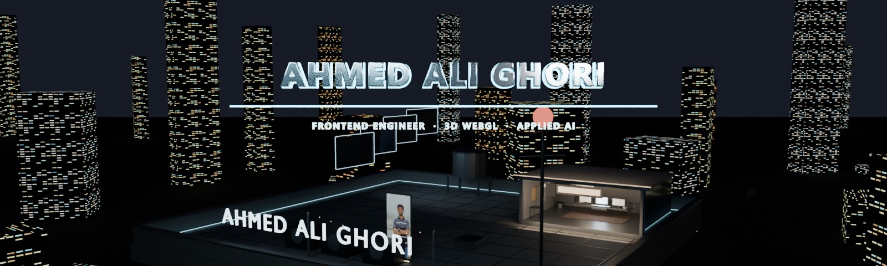

<!--
  Ahmed Ali Ghori · https://github.com/AHMEDALIGHORI
  Custom Blender 5.1.2 Cycles 3D Hero Banner + Visual 3D Showcase + Free GitSkins Neon Telemetry
-->

  

  
  
  
  

  <b>Frontend Engineer · Creative 3D / WebGL Developer · Applied AI Builder</b> 
  BS Computer Science @ Iqra University · Hyderabad, Sindh, Pakistan (GMT+5) · Open to Internships, Junior Roles &amp; Freelance

  <picture>
    <source media="(prefers-color-scheme: light)" srcset="https://www.gitskins.com/api/section/hero?username=AHMEDALIGHORI&theme=neon&mode=light" />
    
  </picture>

---

## Visual Showcase — Interactive 3D & Scroll Cinema

> Click any preview below to launch the live site.

<table>
  <tr>
    <td width="50%" valign="top">
      
       
      <b><a href="https://github.com/AHMEDALIGHORI/ahmed-ali-ghori-3d-portfolio">3D Night Rooftop Portfolio</a></b> · <a href="https://ahmedalighori.github.io/ahmed-ali-ghori-3d-portfolio/">Live Demo ↗</a> 
      Blender · Three.js · Vite · Web Audio — 154 procedural buildings, 9 scroll chapters, 0 stock 3D assets.
    </td>
    <td width="50%" valign="top">
      
       
      <b><a href="https://github.com/AHMEDALIGHORI/GHORI-CITY">GHORI CITY</a></b> · <a href="https://ghori-city.vercel.app">Live Demo ↗</a> 
      Three.js · GSAP · Blender — Interactive 3D portfolio city with six drivable districts.
    </td>
  </tr>
  <tr>
    <td width="50%" valign="top">
      
       
      <b><a href="https://github.com/AHMEDALIGHORI/LOGOFF-01-Touch-Grass">LOGOFF-01 / Touch Grass</a></b> · <a href="https://logooff-01-touch-grass.vercel.app">Live Demo ↗</a> 
      Three.js · Procedural WebGL — 7 exploded shoe parts, 171 generated lugs, 0 runtime images or models.
    </td>
    <td width="50%" valign="top">
      
       
      <b><a href="https://github.com/AHMEDALIGHORI/neon-the-next-interface">NEON: The Next Interface</a></b> · <a href="https://neon-the-next-interface.vercel.app">Live Demo ↗</a> 
      React · Three.js · GLSL · GSAP — Seven-chapter procedural scroll-driven WebGL product film.
    </td>
  </tr>
  <tr>
    <td width="50%" valign="top">
      
       
      <b><a href="https://github.com/AHMEDALIGHORI/mithaas-co">Mithaas &amp; Co.</a></b> · <a href="https://ahmedalighori.github.io/mithaas-co/">Live Demo ↗</a> 
      GSAP · Lenis · Canvas — Luxury mithai storefront with a scroll-opening gold gift box &amp; zero build step.
    </td>
    <td width="50%" valign="top">
      
       
      <b><a href="https://github.com/AHMEDALIGHORI/mudra-house-of-thali">MUDRA · House of the Thali</a></b> · <a href="https://mudra-house-of-thali.vercel.app">Live Demo ↗</a> 
      TypeScript · Three.js — Scroll-controlled editorial dining experience with layered 3D depth.
    </td>
  </tr>
</table>

### More Shipped Builds — Commercial Storefronts, 3D Cities & Applied AI

| Project | Live / Source | Stack | What it is |
| :--- | :--- | :--- | :--- |
| **[Hyderabad City](https://github.com/AHMEDALIGHORI/hyderabad-city)** | [Source](https://github.com/AHMEDALIGHORI/hyderabad-city) | Blender · Three.js · JS | Walkable Vice City × San Andreas–inspired 3D recreation of Hyderabad, Sindh. |
| **[BR Buds](https://github.com/AHMEDALIGHORI/br-buds)** | [Source](https://github.com/AHMEDALIGHORI/br-buds) | Next.js · R3F · GLSL · GSAP | Luxury earbud launch film built entirely in code — zero images, zero renders. |
| **[Wok Wave](https://github.com/AHMEDALIGHORI/wok-wave)** | [wok-wave.vercel.app](https://wok-wave.vercel.app) | Next.js · TypeScript · Tailwind · Motion | Chinese restaurant storefront with scroll-driven food storytelling and menu. |
| **[Mr. Biriyaniwala](https://github.com/AHMEDALIGHORI/mr-biriyaniwala)** | [mr-biriyaniwala.vercel.app](https://mr-biriyaniwala.vercel.app) | HTML · CSS · JS · GSAP · Node 22 | Restaurant site with customizable menu, WhatsApp order handoff &amp; table desk. |
| **[BR-ICE](https://github.com/AHMEDALIGHORI/BR-ICE)** | [br-ice.vercel.app](https://br-ice.vercel.app) | Three.js · Scroll Motion | Animated ice cream storefront featuring an interactive 3D cone builder. |
| **[Astra Cosmos](https://github.com/AHMEDALIGHORI/astra-cosmos)** | [astra-cosmos.vercel.app](https://astra-cosmos.vercel.app) | Three.js · WebGL · Shaders | Scroll-driven cosmic journey with procedural planets, constellations &amp; black hole. |
| **[Nexus Spatial AI](https://github.com/AHMEDALIGHORI/nexus-spatial-ai)** | [Source](https://github.com/AHMEDALIGHORI/nexus-spatial-ai) | 3D Spatial UI · Voice · RAG | Embodied AI assistant with a 3D interface, multilingual voice &amp; local document RAG. |

---

## Tech Stack & Credentials

  
  
  
  
  
  
  
  
  
  
  
  

<table>
  <tr>
    <td width="50%" valign="top">
      <b>Experience &amp; Education</b>
      <ul>
        <li><b>Frontend Developer</b> · Developer Hub Cooperative (2024 – 2026)</li>
        <li><b>Frontend Web Developer</b> · Developer Hub, Islamabad (2023 – Present)</li>
        <li><b>BS Computer Science</b> · Iqra University (2022 – 2026)</li>
      </ul>
    </td>
    <td width="50%" valign="top">
      <b>Certifications</b>
      <ul>
        <li>AWS Generative AI Applications</li>
        <li>Snowflake Generative AI &amp; Data Engineering</li>
        <li>Microsoft SQL Server Specialization</li>
      </ul>
    </td>
  </tr>
</table>

---

## Live Telemetry

  <picture>
    <source media="(prefers-color-scheme: light)" srcset="https://www.gitskins.com/api/section/projects?username=AHMEDALIGHORI&theme=neon&mode=light" />
    
  </picture>

  <picture>
    <source media="(prefers-color-scheme: light)" srcset="https://www.gitskins.com/api/section/stats?username=AHMEDALIGHORI&theme=neon&mode=light" />
    
  </picture>

  <picture>
    <source media="(prefers-color-scheme: light)" srcset="https://www.gitskins.com/api/section/stack?username=AHMEDALIGHORI&theme=neon&mode=light" />
    
  </picture>

  <picture>
    <source media="(prefers-color-scheme: light)" srcset="https://www.gitskins.com/api/section/heatmap?username=AHMEDALIGHORI&theme=neon&mode=light" />
    
  </picture>

  
<b>Off the clock</b> — animated auto-chess replay

   
  

    <picture>
      <source media="(prefers-color-scheme: light)" srcset="https://www.gitskins.com/api/section/chess?username=AHMEDALIGHORI&theme=neon&mode=light" />
      
    </picture>
  

---

## Let's Build Something

Open to **frontend / creative-dev internships & junior roles** (remote or Hyderabad) and **freelance builds** for brands, restaurants, and startups.

- **3D Portfolio:** [ahmedalighori.github.io/ahmed-ali-ghori-3d-portfolio](https://ahmedalighori.github.io/ahmed-ali-ghori-3d-portfolio/)
- **Email:** [ahmedalighori9@gmail.com](mailto:ahmedalighori9@gmail.com)
- **WhatsApp:** [+92 336 8933592](https://wa.me/923368933592)
- **LinkedIn:** [linkedin.com/in/ahmed-ali-ghori-803a0916b](https://www.linkedin.com/in/ahmed-ali-ghori-803a0916b)

  <picture>
    <source media="(prefers-color-scheme: light)" srcset="https://www.gitskins.com/api/section/social?username=AHMEDALIGHORI&theme=neon&mode=light&style=aura" />
    
  </picture>

  Hero rendered in Blender Cycles · Powered by WebGL &amp; GitSkins.

